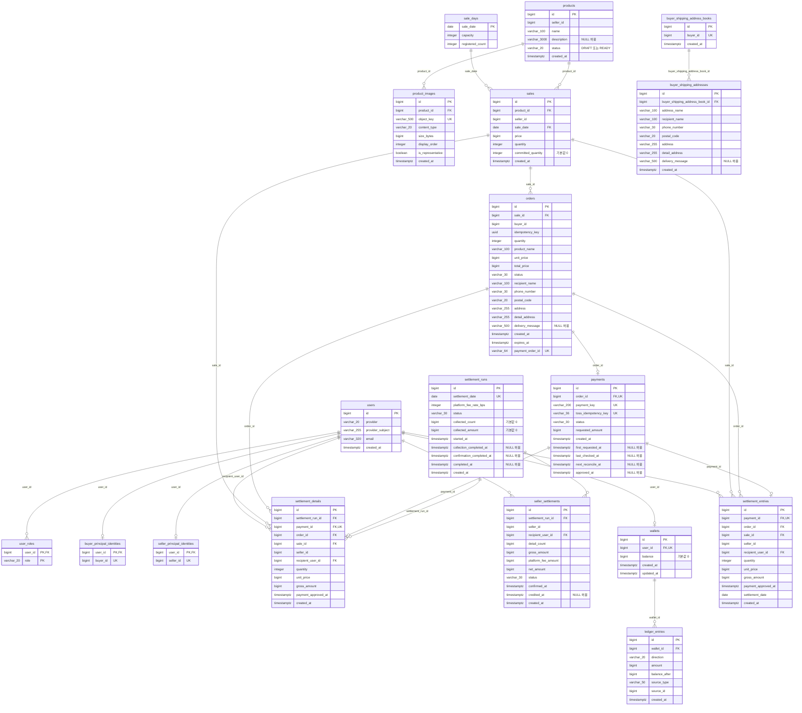
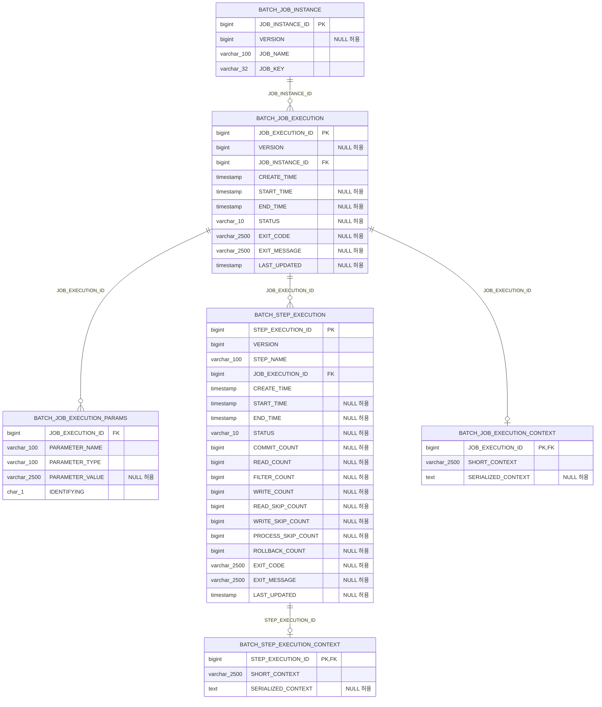

# 데이터베이스 스키마

이 문서는 `apps/backend/src/main/resources/db/migration`의 Flyway migration V1부터 V20까지를 순서대로 적용한 현재 PostgreSQL 스키마를 나타낸다. 애플리케이션 업무 테이블과 Spring Batch 메타데이터 테이블을 분리해 표시한다.

## 표기 규칙

- `PK`, `FK`, `UK`는 각각 기본 키, 외래 키, 단일 컬럼 고유 키를 의미한다.
- Mermaid ER 다이어그램의 관계선은 migration에 선언된 물리 외래 키만 나타낸다.
- `buyer_id`, `seller_id`, `ledger_entries.source_id`처럼 도메인 식별자를 저장하지만 외래 키가 없는 컬럼은 관계선으로 연결하지 않는다.
- 컬럼 설명에 `NULL 허용`이 없으면 `NOT NULL`이다. 단, Spring Batch 공식 스키마에서 `NOT NULL`이 명시되지 않은 컬럼도 `NULL 허용`으로 표시한다.
- 복합 고유 제약, 검사 제약, 인덱스처럼 ER 속성으로 충분히 표현되지 않는 구조는 다이어그램 아래에 별도로 정리한다.

## 업무 테이블

### 복합·조건부 고유 제약

| 테이블 | 컬럼 또는 조건 |
| --- | --- |
| `product_images` | `(product_id, display_order)` |
| `product_images` | `product_id WHERE is_representative` |
| `sales` | `(seller_id, sale_date)` |
| `orders` | `(buyer_id, idempotency_key)` |
| `buyer_shipping_addresses` | `(buyer_shipping_address_book_id, address_name)` |
| `users` | `(provider, provider_subject)` |
| `user_roles` | `(user_id, role)` 기본 키 |
| `seller_settlements` | `(settlement_run_id, seller_id)` |
| `ledger_entries` | `(source_type, source_id)` |

### 상태·핵심 검사 제약

| 테이블 | 제약 요약 |
| --- | --- |
| `products` | `status IN ('DRAFT', 'READY')` |
| `product_images` | 지원 이미지 형식, 1~10 MiB 크기, 0~9 표시 순서 |
| `sale_days` | 양수 정원, `0 <= registered_count <= capacity` |
| `sales` | 양수 가격·판매 수량, `0 <= committed_quantity <= quantity` |
| `orders` | `status IN ('PENDING_PAYMENT', 'PAID', 'EXPIRED', 'PAYMENT_FAILED')`, 양수 수량·금액, 주문 만료 시각·결제 주문 ID 형식 검증 |
| `payments` | `status IN ('CONFIRMING', 'APPROVED', 'FAILED', 'REVIEW_REQUIRED')`, 양수 요청 금액 |
| `users` | `provider = 'GOOGLE'` |
| `user_roles` | `role IN ('BUYER', 'ADMIN')` |
| `settlement_runs` | 정산 수수료율·집계값 범위, 상태와 완료 시각 일관성 |
| `settlement_details` | 양수 수량·단가·총액 |
| `seller_settlements` | 상태와 입금 시각 일관성, `gross_amount = platform_fee_amount + net_amount` |
| `wallets` | 음수가 아닌 잔액 |
| `ledger_entries` | 방향·원천 종류 제한, 양수 금액, 음수가 아닌 변경 후 잔액 |
| `settlement_entries` | 양수 수량·단가·총액, `gross_amount = quantity * unit_price` |

### 업무 인덱스

기본 키와 고유 제약이 자동으로 생성하는 인덱스는 제외한다.

| 인덱스 | 대상 |
| --- | --- |
| `products_seller_ready_id_idx` | `products(seller_id, status, id) INCLUDE (name)` |
| `products_seller_ready_name_id_idx` | `products(seller_id, status, name COLLATE "C", id)` |
| `orders_active_reservation_idx` | `orders(sale_id, expires_at) WHERE status = 'PENDING_PAYMENT'` |
| `orders_paid_sale_idx` | `orders(sale_id) WHERE status = 'PAID'` |
| `orders_buyer_created_id_idx` | `orders(buyer_id, created_at DESC, id DESC)` |
| `payments_reconcile_idx` | `payments(status, next_reconcile_at, id)` |
| `payments_status_approved_at_id_idx` | `payments(status, approved_at, id)` |
| `payments_settlement_partition_idx` | `payments(status, id) INCLUDE (approved_at)` |
| `settlement_details_run_id_id_idx` | `settlement_details(settlement_run_id, id)` |
| `seller_settlements_run_id_id_idx` | `seller_settlements(settlement_run_id, id)` |
| `ledger_entries_wallet_id_id_idx` | `ledger_entries(wallet_id, id)` |
| `settlement_entries_settlement_date_id_idx` | `settlement_entries(settlement_date, id)` |

## Spring Batch 메타데이터 테이블

`BATCH_JOB_INSTANCE`에는 `(JOB_NAME, JOB_KEY)` 고유 제약이 있다. Spring Batch 식별자 생성을 위해 `BATCH_JOB_INSTANCE_SEQ`, `BATCH_JOB_EXECUTION_SEQ`, `BATCH_STEP_EXECUTION_SEQ` 시퀀스를 사용한다.

## 기타 시퀀스와 제거된 테이블

- `buyer_domain_id_seq`: 구매자 도메인 식별자를 생성한다.
- `sale_inventory_counters`, `inventory_reservations`: V15에서 생성되었지만 V20에서 제거되었으므로 현재 스키마에는 존재하지 않는다.
